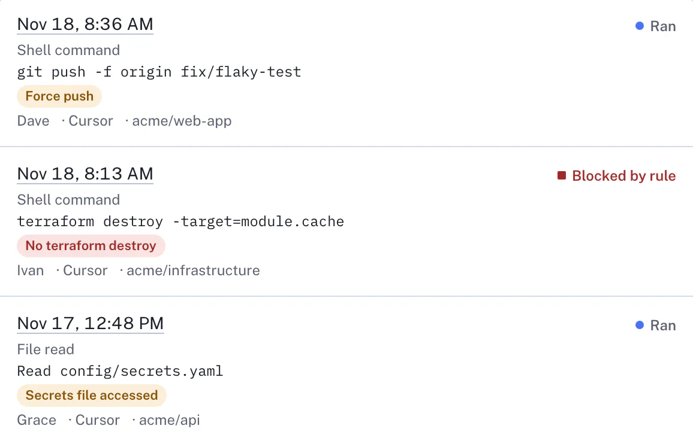
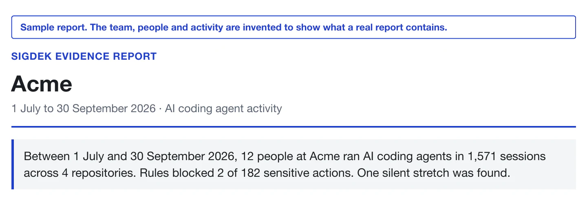
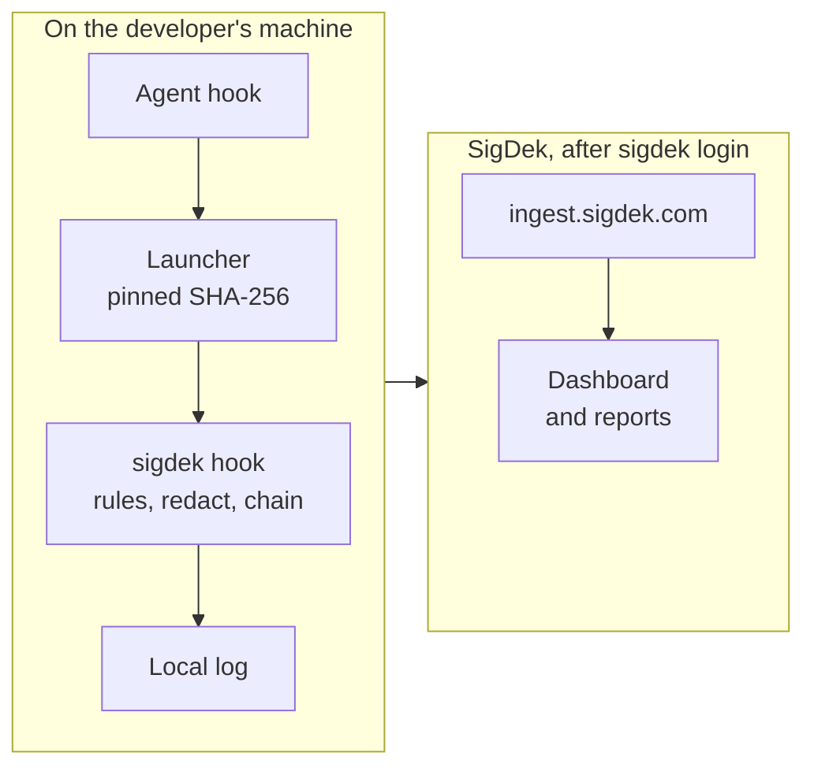
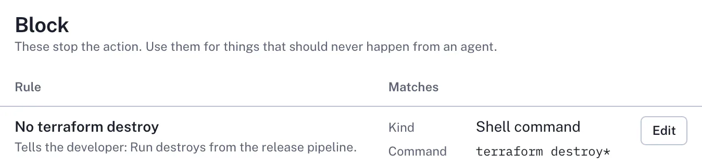

#  SigDek recorder

SigDek records what AI coding agents do on your team's machines (who ran which agent, which tool, the command or file, and whether it ran or was blocked) and turns that record into evidence an auditor or a customer can read.

**Free and paid.** The recorder and plugins in this repository are free and open source (Apache-2.0). They record to a local log on your machine with no account, and their 12 built-in rules flag risky actions and block nothing. The team dashboard, your team's own Flag and Block rules, and evidence reports need a SigDek plan: Team is $99 a month for up to 10 people and Business $199 for up to 50, with a 14-day trial and no card. [Pricing](https://sigdek.com/pricing/)

[](https://github.com/tektonsoftware/sigdek/releases/latest)
[](https://github.com/tektonsoftware/sigdek/actions/workflows/ci.yml?query=branch%3Amain)
[](https://www.npmjs.com/package/sigdek)
[](LICENSE)

<picture>
  <source media="(prefers-color-scheme: dark)" srcset="docs/images/activity-blocked-dark-2x.webp">
  
</picture>

<sub>The Activity page of the hosted dashboard, for a demo team with invented people.</sub>

## What it does

- **Records each agent action** in Claude Code and Cursor: who, which agent, which tool, the command or file path, and the outcome. It never records prompt text, file contents or command output.
- **Applies rules on the machine.** Block rules stop an action before it runs; Flag rules mark it in the record. Without an account, only the built-in Flag rules apply.
- **The hosted service at [sigdek.com](https://sigdek.com)** (paid) turns the records into a team dashboard and an evidence report. Anyone can check at [app.sigdek.com/verify](https://app.sigdek.com/verify) that a report's PDF or CSV came from SigDek and hasn't changed since.



This repository is the open-source recorder that runs on developer machines, plus the Claude Code and Cursor plugins that install it. SigDek is a product of Tekton Software.

## Quick start

### Just me, in Claude Code

Records you, in every project you open in Claude Code on this machine. In Claude Code in a terminal, type these in its chat:

```
/plugin marketplace add tektonsoftware/sigdek
/plugin install sigdek@sigdek
/sigdek:connect
```

`/sigdek:connect` shows a link and a code; approve the same code in your browser. The `/plugin` commands don't run in VS Code or the desktop app: [steps for those](docs/setup.md#just-me-in-claude-code).

### Our team's project

Records everyone who works in a project, in Claude Code and Cursor. In a terminal, in the project's top folder:

```sh
npx sigdek init
git add .claude/settings.json .cursor/hooks.json .sigdek
git commit -m "Record agent activity with SigDek"
npx sigdek login
```

If anyone uses Cursor on Windows in the project, run `npx sigdek init --windows` instead ([why](docs/setup.md#cursor-on-windows)). Then invite your team: in the dashboard, open People and choose **Invite people**. Each teammate accepts the invitation, then runs `npx sigdek login` once. Without an invitation, signing in asks them to name a new team instead. [Full steps](docs/setup.md#our-teams-project)

### I use Cursor

SigDek's Cursor plugin isn't on Cursor's Marketplace yet, so follow [Our team's project](#our-teams-project) in Cursor's terminal. [Steps for Cursor](docs/setup.md#i-use-cursor)

### Try it without an account

Run `npx sigdek init` in a project (or add the plugin), give your agent a task, then run `npx sigdek log` to see what was recorded and `npx sigdek verify` to check the local chain. Nothing leaves the machine until you sign in.

`npx` needs Node.js 18 or later. Without it, [get the `sigdek` command](#getting-the-sigdek-command) and type `sigdek` for `npx sigdek`.

## Did it work?

In the project's folder, `npx sigdek status` answers as a checklist, without going online. After the agent's first action, before signing in:

```
[x] Claude Code records in this project, through its hooks in .claude/settings.json
[x] Cursor records in this project, through its hooks in .cursor/hooks.json
    Cursor on Windows can't run these hooks. If anyone uses Cursor on Windows here, run
    `npx sigdek init --windows` and commit the change.
[x] SigDek 0.1.1, the recorder this project pins, is downloaded and matches its checksum
[ ] This machine isn't connected to a team, so its records stay on it
    Next: run `npx sigdek login`.
```

Once signed in, that item reads `[x] Connected to Acme as alice@acme.example`, and an item on uploads follows, such as `[x] Uploads work: the last one finished just now, and nothing is waiting`. `[ ]` marks something missing, with the next step under it. [Did it work?](docs/setup.md#did-it-work) has the full output, and [If something goes wrong](docs/setup.md#if-something-goes-wrong) the fixes.

## What it records, and what it never does

- **Never recorded:** prompt text (only a hash and its length), file contents, command output. The stored hashes can confirm a guess at a whole input. [More](docs/recording.md#never-recorded)
- **Secrets are stripped** from commands, paths and URLs before anything is written. It's best effort. [More](docs/recording.md#secrets-are-stripped)
- **Tamper-evident once SigDek has received them:** a hash chain per machine, checked on every upload. The local log can be rewritten by someone with access to the machine before it uploads. [More](docs/recording.md#tamper-evident-once-sigdek-has-received-them)
- **Never blocks by accident:** any error lets the action go ahead, and only your team's Block rules stop an action. Two exceptions: the PowerShell-only Cursor form, and Cursor's own bug that shows "Hook blocked" for its CLI on Windows started from Git Bash. [More](docs/recording.md#never-blocks-your-work-by-accident)
- **Anyone using the machine can switch recording off,** by removing the hooks, uninstalling the plugin or setting `SIGDEK_BIN`. The built-in rules flag an agent editing SigDek's setup, and the Coverage report shows a machine that goes silent; neither prevents it. [More](docs/recording.md#can-be-switched-off-by-anyone-using-the-machine)
- **Fast:** a few milliseconds per event; CI fails the build when the slowest 5% take over 50 ms. The first event on a machine waits for a download, and nothing is recorded until it completes. [More](docs/recording.md#fast)

[SECURITY.md](SECURITY.md) says what SigDek does and doesn't promise.

## How it works



The agent's hook runs a small launcher, which downloads only the recorder version the project or plugin pins and refuses it unless its SHA-256 matches. The recorder applies the rules, answers the agent, strips secrets and seals the record into the machine's hash chain. Once the machine is signed in, a separate process uploads the log; the one exception is an action that changes SigDek's own setup, whose record the hook uploads itself, waiting at most about a second. [How it works](docs/how-it-works.md) has the details.

## Getting the sigdek command

`npx sigdek …` works anywhere Node.js 18 or later is installed. To install the `sigdek` command instead:

| Where | Install |
|---|---|
| Any OS, with Node.js | `npm install -g sigdek` |
| macOS and Linux, without Node.js | `curl -fsSL https://sigdek.com/install.sh \| sh`, or without curl, `wget -qO- https://sigdek.com/install.sh \| sh` (prefer curl: whether wget checks certificates depends on how it was built) |
| Windows, Scoop | `scoop bucket add sigdek https://github.com/tektonsoftware/sigdek` then `scoop install sigdek` |
| Go 1.24 or later | `go install github.com/tektonsoftware/sigdek/cmd/sigdek@latest` |
| Anything else | The binary for your platform from [GitHub releases](https://github.com/tektonsoftware/sigdek/releases), checked against `checksums.txt` |

winget isn't available yet: SigDek's first submission is waiting for Microsoft's review. [Installing](docs/install.md) covers reading the install script first, its settings, and what each channel installs.

## Commands

| Command | What it does |
|---|---|
| `sigdek init` | Add SigDek's hooks to the current repository. `--windows` writes Cursor hooks that also run on Windows; `--remove` takes them out. `sigdek init -h` lists every option |
| `sigdek login` | Connect this machine to your team; sign-in happens in the browser |
| `sigdek logout` | Disconnect this machine. [More](docs/setup.md#commands) |
| `sigdek status` | A checklist of what is set up and working, with the next step for anything that isn't |
| `sigdek log` | Recent records from this machine |
| `sigdek verify` | Check that no local record was changed or removed |
| `sigdek flush` | Upload now, without waiting out a back-off |

## Rules

Teams set rules in the dashboard. A **Flag** rule marks matching actions in the report; a **Block** rule stops them before they run and tells the agent and the developer why. Until a machine signs in, 12 built-in rules flag common risky actions and block nothing. Patterns are globs or, with `re:`, RE2 regular expressions. [Rules](docs/rules.md) has the matching details.

<picture>
  <source media="(prefers-color-scheme: dark)" srcset="docs/images/rule-block-dark-2x.webp">
  
</picture>

## Platforms and limits

- **Windows, Claude Code:** records only where Git for Windows is installed. [Windows](docs/windows.md)
- **Windows, Cursor:** needs `npx sigdek init --windows` (or `init` run on Windows). Those hooks run in CI as Cursor is reported to run them, but haven't been tried in the Cursor app on Windows. [Windows](docs/windows.md)
- **Cursor plugin:** not on Cursor's Marketplace yet. Set up the project with `sigdek init`, or add the plugin to a Teams or Enterprise team marketplace. [Cursor](docs/cursor.md)
- **Declined actions:** an action someone declines at the agent's permission prompt leaves no record. [More](docs/recording.md)

## More documentation

- [Setting up SigDek](docs/setup.md): the three paths step by step, status, and fixes
- [Installing the sigdek command](docs/install.md)
- [What it records, and what it never does](docs/recording.md)
- [Rules](docs/rules.md)
- [How it works](docs/how-it-works.md)
- [Cursor](docs/cursor.md) and [Windows](docs/windows.md)
- [Developing SigDek](docs/develop.md), including releases
- [SECURITY.md](SECURITY.md): reporting a vulnerability, and what SigDek does and doesn't promise
- [sigdek.com/docs](https://sigdek.com/docs/): the hosted service

## Develop

The recorder needs Go 1.24 or later and uses only the standard library. Run `go test ./...` and build with `go build -o sigdek ./cmd/sigdek`. [Developing SigDek](docs/develop.md) says how to make the launchers use your build, and how releases work.

## License

Apache-2.0. Copyright 2026 Tekton Software LLC. Report security issues as described in [SECURITY.md](SECURITY.md).
