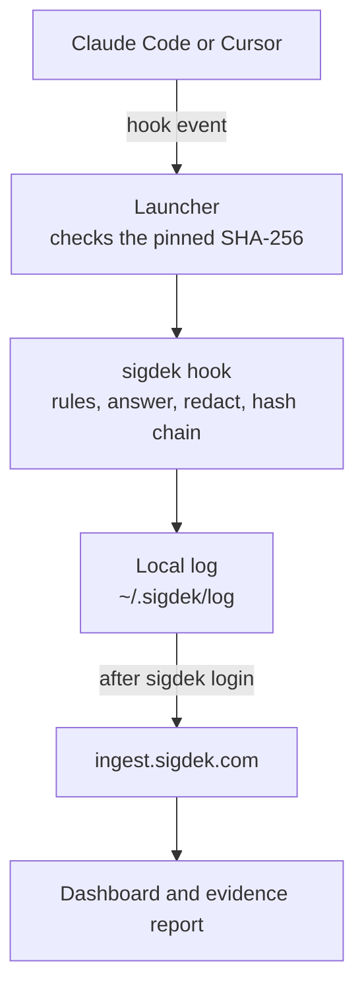

#  SigDek recorder

SigDek records what AI coding agents do on your team's machines (who ran which agent, which tool, the command or file, and whether it ran or was blocked) and turns that record into evidence an auditor or a customer can read.

[](https://github.com/tektonsoftware/sigdek/releases/latest)
[](https://github.com/tektonsoftware/sigdek/actions/workflows/ci.yml?query=branch%3Amain)
[](https://www.npmjs.com/package/sigdek)
[](LICENSE)

<picture>
  <source media="(prefers-color-scheme: dark)" srcset="docs/images/activity-blocked-dark-2x.webp">
  
</picture>

<sub>The Activity page of the hosted dashboard, for a demo team with invented people.</sub>

## What it does

- **Records each agent action** in Claude Code and Cursor: who, which agent, which tool, the command or file path, and the outcome. Never prompt text, file contents or command output.
- **Applies your team's Flag and Block rules** on the machine, before the action runs.
- **The hosted service at [sigdek.com](https://sigdek.com)** turns the records into a team dashboard and an evidence report that anyone can check at [app.sigdek.com/verify](https://app.sigdek.com/verify).


This repository is the open-source recorder that runs on developer machines, plus the Claude Code and Cursor plugins that install it, under Apache-2.0. SigDek is a product of Tekton Software.

## Quick start

| Path | For | Commands | Full steps |
|---|---|---|---|
| Just me, in Claude Code | Recording yourself, in every project you open in Claude Code on this machine | `/plugin marketplace add tektonsoftware/sigdek`, `/plugin install sigdek@sigdek`, `/sigdek:connect` | [setup.md](docs/setup.md#just-me-in-claude-code) |
| Our team's project | Everyone who works in a project, in Claude Code and Cursor. You can change the project. | `npx sigdek init`, commit, `npx sigdek login` | [setup.md](docs/setup.md#our-teams-project) |
| I use Cursor | Cursor users. The Cursor plugin isn't on Cursor's Marketplace yet. | The team project's steps, in Cursor | [setup.md](docs/setup.md#i-use-cursor) |

**Just me, in Claude Code.** In Claude Code's chat (in VS Code or the desktop app, [see the steps](docs/setup.md#just-me-in-claude-code)):

```
/plugin marketplace add tektonsoftware/sigdek
/plugin install sigdek@sigdek
/sigdek:connect
```

`/sigdek:connect` shows a link and a code; approve the same code in your browser.

**Our team's project.** In a terminal, in the project's top folder:

```sh
npx sigdek init
git add .claude/settings.json .cursor/hooks.json .sigdek
git commit -m "Record agent activity with SigDek"
npx sigdek login
```

If anyone uses Cursor on Windows in the project, run `npx sigdek init --windows` instead ([why](docs/setup.md#cursor-on-windows)). Each teammate runs `npx sigdek login` once.

`npx` needs Node.js 18 or later. Without it, [get the `sigdek` command](#getting-the-sigdek-command) and type `sigdek` for `npx sigdek`.

## Did it work?

In the project's folder, `npx sigdek status` answers as a checklist, without going online:

```
sigdek 0.1.1 (darwin/arm64)

[x] Claude Code records in this project, through its hooks in .claude/settings.json
[x] Cursor records in this project, through its hooks in .cursor/hooks.json
    Cursor on Windows can't run these hooks. If anyone uses Cursor on Windows here, run
    `npx sigdek init --windows` and commit the change.
[x] SigDek 0.1.1, the recorder this project pins, is downloaded and matches its checksum
[x] Connected to Acme as alice@acme.example
[x] Uploads work: the last one finished just now, and nothing is waiting
```

That's from a Mac with plain `npx sigdek init` hooks; with `--windows` hooks the note under Cursor isn't there. `[ ]` marks something missing, with the next step under it. [Did it work?](docs/setup.md#did-it-work) has the full output, and [If something goes wrong](docs/setup.md#if-something-goes-wrong) the fixes.

## What it records, and what it never does

- **Never recorded:** prompt text (only a hash and its length), file contents, command output. The stored hashes can confirm a guess at a whole input. [More](docs/recording.md#never-recorded)
- **Secrets are stripped** from commands, paths and URLs before anything is written. It's best effort. [More](docs/recording.md#secrets-are-stripped)
- **Tamper-evident once SigDek has received them:** a hash chain per machine, checked on every upload. The local log can be rewritten by someone with access to the machine before it uploads. [More](docs/recording.md#tamper-evident-once-sigdek-has-received-them)
- **Never blocks by accident:** any error lets the action go ahead. Only your team's Block rules stop an action (one exception: the PowerShell-only Cursor form). [More](docs/recording.md#never-blocks-your-work-by-accident)
- **Anyone using the machine can switch recording off,** by removing the hooks, uninstalling the plugin or setting `SIGDEK_BIN`. The built-in rules flag an agent editing SigDek's setup, and the Coverage report shows a machine that goes silent; neither prevents it. [More](docs/recording.md#can-be-switched-off-by-anyone-using-the-machine)
- **Fast:** a few milliseconds per event; CI fails the build when the slowest 5% take over 50 ms. The first event on a machine waits for a download. [More](docs/recording.md#fast)

[SECURITY.md](SECURITY.md) says what SigDek does and doesn't promise.

## How it works



The agent's hook runs a small launcher, which downloads only the recorder version the project or plugin pins and refuses it unless its SHA-256 matches. The recorder applies the rules, answers the agent, strips secrets and seals the record into the machine's hash chain. A separate process uploads the log once the machine is signed in. [How it works](docs/how-it-works.md) has the details.

## Getting the sigdek command

`npx sigdek …` works anywhere Node.js 18 or later is installed. To install the `sigdek` command instead:

| Where | Install |
|---|---|
| Any OS, with Node.js | `npm install -g sigdek` |
| macOS and Linux, without Node.js | `curl -fsSL https://sigdek.com/install.sh \| sh`, or without curl, `wget -qO- https://sigdek.com/install.sh \| sh` (prefer curl) |
| Windows, Scoop | `scoop bucket add sigdek https://github.com/tektonsoftware/sigdek` then `scoop install sigdek` |
| Windows, winget | `winget install TektonSoftware.SigDek`, a few days after each release |
| Go 1.24 or later | `go install github.com/tektonsoftware/sigdek/cmd/sigdek@latest` |
| Anything else | The binary for your platform from [GitHub releases](https://github.com/tektonsoftware/sigdek/releases), checked against `checksums.txt` |

[Installing](docs/install.md) covers reading the install script first, its settings, and what each channel installs.

## Commands

| Command | What it does |
|---|---|
| `sigdek init` | Add SigDek's hooks to the current repository. `--windows` writes Cursor hooks that also run on Windows; `--remove` takes them out, and `.sigdek/` once no hooks use it. `sigdek init -h` lists every option |
| `sigdek login` / `logout` | Connect or disconnect this machine; sign-in happens in the browser. Logout asks the server that signed it in to revoke the machine's token and says if it couldn't. Agents are still recorded after logout, on the machine only; those records upload if it signs in to the same team again, and login says how many |
| `sigdek status` | A checklist of what is set up and working, with the next step for anything that isn't. It reads only local files |
| `sigdek log` | Recent records from this machine |
| `sigdek verify` | Check that no local record was changed or removed |
| `sigdek flush` | Upload now (normally automatic, in the background), without waiting out a back-off |

## Rules

Teams set rules in the dashboard. A **Flag** rule marks matching actions in the report; a **Block** rule stops them before they run and tells the agent and the developer why. Until a machine signs in, 12 built-in rules flag common risky actions and block nothing. Patterns are globs or, with `re:`, RE2 regular expressions. [Rules](docs/rules.md) has the matching details.

<picture>
  <source media="(prefers-color-scheme: dark)" srcset="docs/images/rule-block-dark-2x.webp">
  
</picture>

## Platforms and limits

- **Windows, Claude Code:** records only where Git for Windows is installed. [Windows](docs/windows.md)
- **Windows, Cursor:** needs `npx sigdek init --windows` (or `init` run on Windows). Those hooks run in CI as Cursor is reported to run them, but haven't been tried in the Cursor app on Windows. [Windows](docs/windows.md)
- **Cursor plugin:** not on Cursor's Marketplace yet. Set up the project with `sigdek init`, or add the plugin to a Teams or Enterprise team marketplace. [Cursor](docs/cursor.md)
- **Declined actions:** an action someone declines at the agent's permission prompt leaves no record. [More](docs/recording.md)

## More documentation

- [Setting up SigDek](docs/setup.md): the three paths step by step, status, and fixes
- [Installing the sigdek command](docs/install.md)
- [What it records, and what it never does](docs/recording.md)
- [Rules](docs/rules.md)
- [How it works](docs/how-it-works.md)
- [Cursor](docs/cursor.md) and [Windows](docs/windows.md)
- [Developing SigDek](docs/develop.md), including releases
- [SECURITY.md](SECURITY.md): reporting a vulnerability, and what SigDek does and doesn't promise
- [sigdek.com/docs](https://sigdek.com/docs/): the hosted service

## Develop

Go 1.24 or later, standard library only: `go test ./...`, then `go build -o sigdek ./cmd/sigdek`, and set `SIGDEK_BIN=$PWD/sigdek` to make launchers use your build instead of downloading. [Developing SigDek](docs/develop.md) has more, and how releases work.

## License

Apache-2.0. Copyright 2026 Tekton Software LLC. Report security issues as described in [SECURITY.md](SECURITY.md).
