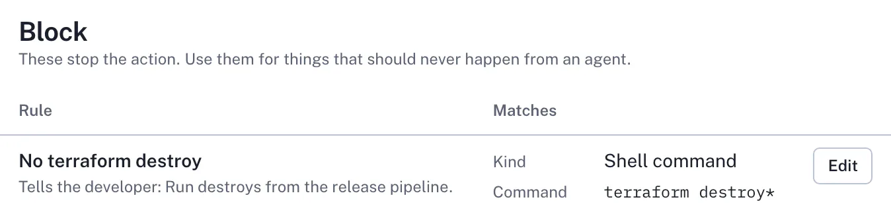

[Back to the README](../README.md)

# Rules

Teams set rules in the dashboard. A **Flag** rule marks matching actions in the report; a **Block** rule (`deny` in the API) stops them before they run, and tells the agent and the developer why.

<picture>
  <source media="(prefers-color-scheme: dark)" srcset="images/rule-block-dark-2x.webp">
  
</picture>

## Built-in rules

Until a machine signs in, 12 built-in rules ([schema/default-rules.json](../schema/default-rules.json)) flag common risky actions and block nothing: force pushes, recursive deletes, secrets files, infrastructure changes, destructive SQL, piping a download into a shell, publishing packages, privileged commands, history rewrites, and changes to SigDek's own setup.

The built-in rules read a command's words, not what it is for, so they can flag a command that only mentions a risky one in a commit message, PR text or heredoc: `git commit -m "Run terraform apply in CI"` is flagged as an infrastructure change. A built-in rule switched to Block refuses such a command too.

## Patterns

Patterns are globs (`*` matches anything; in paths `**` crosses `/`) or, with `re:`, RE2 regular expressions.

- Command and URL patterns are found anywhere in the text.
- Path patterns match the whole path or any part after a `/`.
- Tool and MCP globs match the whole name: `Write` matches Write but not TodoWrite, and `github/merge_*` matches the server github but not mygithub. An MCP glob without `/` names the tool.
- Claude Code names a claude.ai connector's server `claude_ai_<Name>`, such as `claude_ai_GitHub`, and a plugin's server `plugin_<plugin>_<server>`, so `github/merge_*` misses their tools. `*/merge_*` matches the tool on any server, and `re:(?i)github/merge_` matches all three names.
- Patterns are case-sensitive, apart from the program name at the start of each command, which is also read in lower case. So `drop table` misses `DROP TABLE`, and on macOS and Windows, where file names ignore case, `**/prod-secrets.yml` misses `PROD-SECRETS.yml`. Start a pattern with `re:(?i)` to ignore case, as in `re:(?i)(^|/)prod-secrets\.yml$`.
- A glob matches its text in that order: `rm -rf*` doesn't match `rm -fr` or `rm -r -f`, and `terraform destroy*` doesn't match `terraform -chdir=infra destroy` or `terraform apply -destroy`. To catch every spelling, use `re:`, such as `re:\b(terraform|tofu)\s+(-\S+\s+)*(destroy\b|apply\b[^|;&\n]*\s-destroy\b)`, or switch a built-in rule (Recursive delete, Force push, Infrastructure change, Remote script piped to a shell) to Block. A built-in rule covers more than one command: set to Block, Infrastructure change also stops every `terraform apply`, and Recursive delete a plain `rm -r build`.

Rules are checked before anything is cut or redacted. Block rules read the whole command, up to 8 MB of hook input, as the agent sent it and as the shell reads it; Flag rules read up to 16 KB of it. A command put together at run time can't be seen through. [What it records](recording.md#bounded) and [SECURITY.md](../SECURITY.md) say what rules can and can't see.

Command rules check what an agent runs through its shell tool: Claude Code's Bash and Cursor's shell. From 0.1.2 they also check commands sent through Claude Code's Monitor and PowerShell tools, or any other of its tools (MCP tools aside) whose input is a `command`, and these are recorded with their command like Bash commands. Before 0.1.2, those two are recorded by tool name only, with no command, and a Block rule on the tool name `Monitor` or `PowerShell` is what stops them. A PowerShell command is read the way sh would read it, and the built-in rules are written for sh, so they don't catch PowerShell cmdlets such as `Remove-Item -Recurse`.

Path rules judge the path a tool names, not the files it goes on to read. From 0.1.2, a Grep or Glob search is also judged by its folder (the session's folder when it names none) joined with its glob, so a search with the glob `.env`, `**/.env`, `.env.*`, `*.pem` or `*.key` meets the built-in Secrets file rule. A glob that reaches a secret file only through wildcards or braces, such as `.env*`, `id_*` or `{.env,.npmrc}`, can get past that rule, and a search with no glob is judged by its folder alone, so it can return lines from a secrets file in that folder. Before 0.1.2, every search is judged by its folder alone.

Each record carries one rule: a blocked action the first Block rule it matched, any other action the first Flag rule it matched. Rules are tried in the order they were added, so the built-in rules come first, and an action that matches a built-in rule and one of your team's Flag rules is counted under the built-in rule.

## MCP tools in Cursor

Cursor's general `preToolUse` and `postToolUse` hooks, which SigDek uses, don't name the MCP server, so for Cursor an MCP pattern like `github/merge_*` matches on the tool part. Cursor's MCP-specific hooks do name it, but SigDek doesn't use them yet.

## When rules change

Each upload brings back the team's current rules; a rule the recorder can't use is written to `~/.sigdek/errors.log` when it arrives. `sigdek status` shows how many Flag and Block rules are in use, and names any rule that isn't working.
