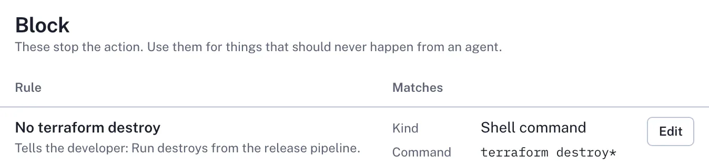

[Back to the README](../README.md)

# Rules

Teams set rules in the dashboard. A **Flag** rule marks matching actions in the report; a **Block** rule (`deny` in the API) stops them before they run, and tells the agent and the developer why.

<picture>
  <source media="(prefers-color-scheme: dark)" srcset="images/rule-block-dark-2x.webp">
  
</picture>

## Built-in rules

Until a machine signs in, 12 built-in rules ([schema/default-rules.json](../schema/default-rules.json)) flag common risky actions and block nothing: force pushes, recursive deletes, secrets files, infrastructure changes, destructive SQL, piping a download into a shell, publishing packages, privileged commands, history rewrites, and changes to SigDek's own setup.

## Patterns

Patterns are globs (`*` matches anything; in paths `**` crosses `/`) or, with `re:`, RE2 regular expressions.

- Command and URL patterns are found anywhere in the text.
- Path patterns match the whole path or any part after a `/`.
- Tool and MCP globs match the whole name: `Write` matches Write but not TodoWrite, and `github/merge_*` matches the server github but not mygithub. An MCP glob without `/` names the tool.

Rules are checked before anything is cut or redacted. Block rules read the whole command, as the agent sent it and as the shell reads it; Flag rules read up to 16 KB of it. A command put together at run time can't be seen through. [What it records](recording.md#bounded) and [SECURITY.md](../SECURITY.md) say what rules can and can't see.

## MCP tools in Cursor

Cursor's general `preToolUse` and `postToolUse` hooks, which SigDek uses, don't name the MCP server, so for Cursor an MCP pattern like `github/merge_*` matches on the tool part. Cursor's MCP-specific hooks do name it, but SigDek doesn't use them yet.

## When rules change

Each upload brings back the team's current rules; a rule the recorder can't use is written to `~/.sigdek/errors.log` when it arrives. `sigdek status` shows how many Flag and Block rules are in use, and names any rule that isn't working.
